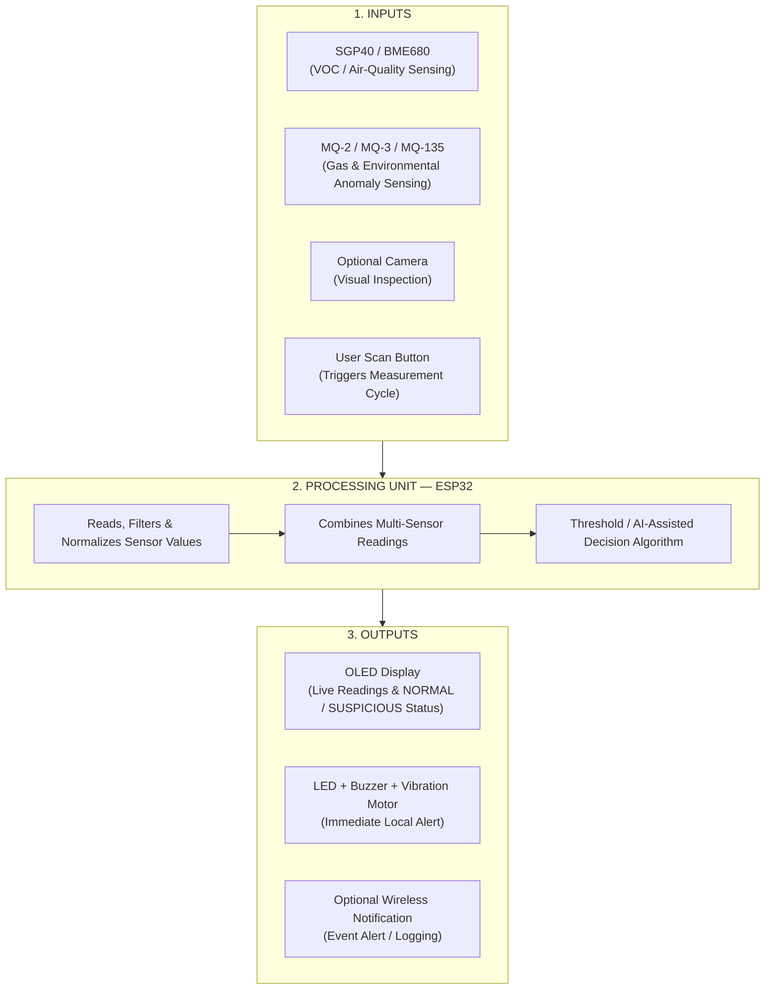

# INTELLIDETECT

**Low-Cost Handheld Device/System for Real-Time Screening of Narcotics & Explosives across Indian Railways**

**INTELLIDETECT** is a low-cost, ESP32-based handheld multi-sensor screening prototype that detects abnormal chemical-vapour and air-quality conditions and delivers real-time local alerts for railway security personnel.

---

## Problem Statement

Developing a mobile (quadruped) or handheld device/system capable of real-time screening for narcotics and explosives across Indian Railways.

## Objective

To build a portable, inexpensive proof-of-concept demonstrating multi-sensor chemical-vapour screening, on-device real-time processing, and immediate multi-modal alerts for suspicious air-quality conditions in railway environments—without the high cost and complexity of a quadruped robotic platform.

---

## System Architecture & Working Flow

The system follows a streamlined five-stage field workflow: **`Sense → Process → Decide → Alert → Log/Notify`**.

### Step-by-Step Operation
1. **Air / Sample Intake:** The target area, luggage, or parcel is brought into the scanning zone and the user triggers a manual scan.
2. **Sensing:** VOC, gas, and environmental sensors collect raw readings.
3. **Signal Processing:** The ESP32 reads, filters, and normalizes the incoming sensor data.
4. **Detection Algorithm:** Threshold
